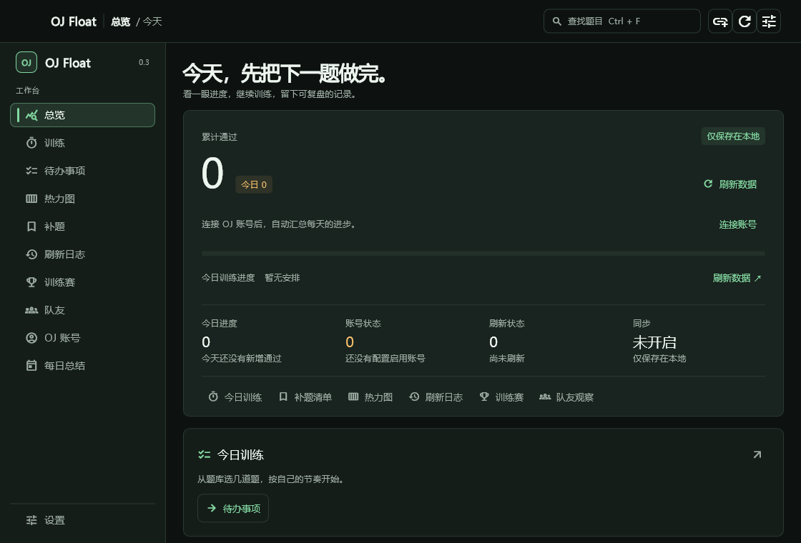
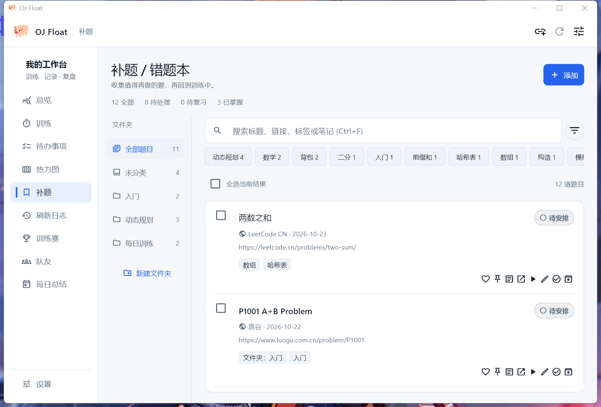
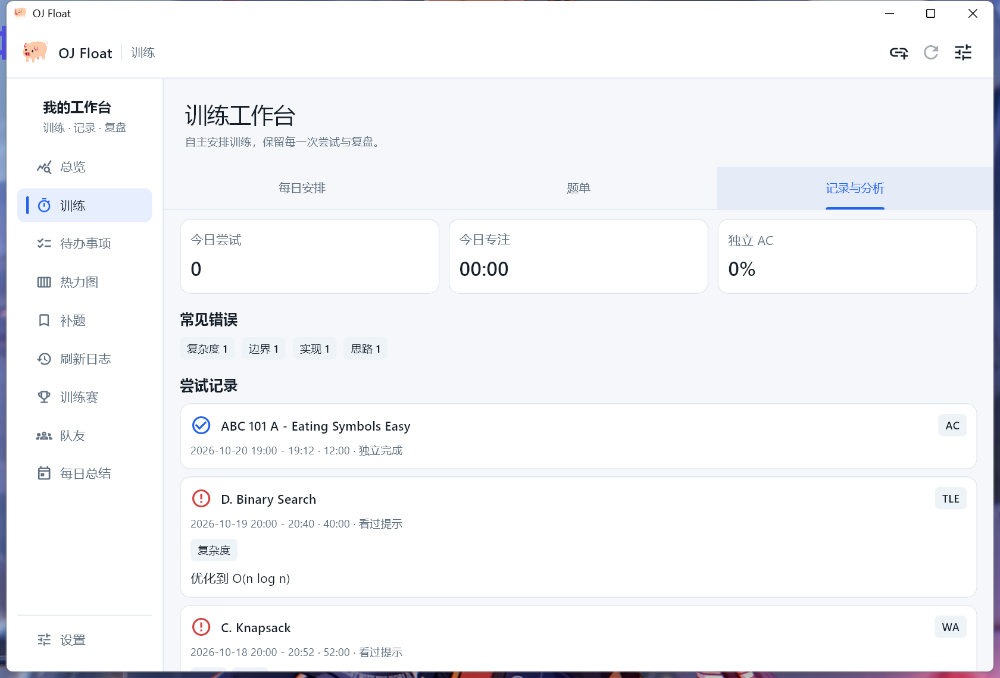
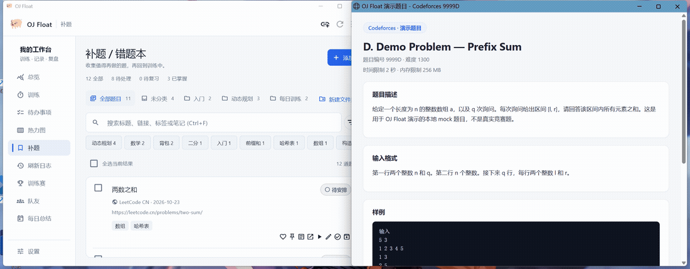

# OJ Float

OJ Float 是一个 Windows 桌面训练客户端，用来集中查看多个 Online Judge 账号的刷题进度、今日增量、补题记录、比赛记录、队友观察和刷新日志。

当前稳定版本：`v0.3.0`（build 9）

后续改进、任务认领与验收约定见 [后续改进协作文档](docs/improvement-collaboration.md)。

## 下载

在 [GitHub Releases](https://github.com/ZuesHans/oj-desktop-widget/releases/latest) 下载 Windows 10 / 11 x64 安装包：

```text
OJ-Float-v0.3.0-windows-x64-setup.exe
```

1. 运行安装包，按当前用户安装，无需管理员权限。
2. 从开始菜单打开 OJ Float 或 OJ Problem Companion（轻量题库）。桌面快捷方式可在安装时选中。
3. 首次使用可以直接保存一道题，也可以跳过引导；OJ 账号可稍后配置。

后续下载新版安装包覆盖安装即可；卸载默认保留题库、配置和训练记录。设置底部提供手动检查更新和下载入口。安装包尚未进行发布者代码签名。

也提供 `OJ-Float-v0.3.0-windows-x64.zip` 免安装包。请完整解压后运行 `oj_float.exe`，保留同目录的 `data` 和所有 DLL。两种发行方式使用同一份本机数据。发布页附 SHA-256 校验文件。

## 界面与演示

下面的截图与演示来自可运行的 `v0.3.0`，使用 [`scripts/showcase/`](scripts/showcase/) 中的可复现演示数据生成，不含任何真实账号、笔记、令牌或本机用户名。完整复现步骤见 [docs/showcase-runbook.md](docs/showcase-runbook.md)。

### 总览工作台



### 题库



### 训练与复盘



### 浏览器存题演示



演示流程：浏览器题目页 → 一键存题 → 题目出现在客户端题库。该演示为脚本驱动：本地 mock 题目页与 `scripts/showcase/import_problem.ps1` 直接调用客户端的回环导入接口 `127.0.0.1:27121`，等价于浏览器扩展的一键存题动作；未使用真实浏览器扩展或真实题目。

## 这一版有什么变化

`v0.3.0` 在 `v0.2.0` 基础上增加窗口状态记忆、仪表盘快捷键、剪贴板预填、诊断日志与发布链加固。

- 记住并恢复窗口大小、位置与最大化状态，开机静默启动时保持隐藏。
- 仪表盘新增数字键 1–9 切换页签、`Ctrl+N` 快速录入、`Ctrl+,` 打开设置。
- 快速录入识别剪贴板中的 OJ 题目链接并预填，不自动请求、不覆盖已编辑内容。
- 新增本地轮转诊断日志（1 MiB × 5）与脱敏导出，异常可复现、隐私不落地。
- 发布链加固：CI 固定 Flutter 版本、发布说明取自标签、附构建来源证明。

`v0.2.0` 将产品从多级悬浮窗收敛为标准 Windows 桌面客户端：

- 正常启动直接进入完整 Dashboard，使用原生标题栏、任务栏、缩放和最大化。
- 默认关闭即退出；用户可在设置中主动开启关闭到托盘和登录时静默启动。
- 设置集中到 Dashboard 正式页面，支持显式保存、保存并同步和未保存离开确认。
- 移除紧凑窗、大浮窗、窗口置顶、隐藏任务栏和窗口尺寸切换。
- 新增 Windows 单实例保护；再次启动会恢复并聚焦已有窗口。
- 配置升级到版本 4，同时兼容旧配置和旧版便携备份。
- 内存、磁盘、刷新和备份中的历史快照统一保留最近 6000 条。

## 工作台自定义

界面沿用交互演示的文字层级与留白，首页以进度摘要和训练安排为主，题库提供常驻文件夹与列表浏览。侧栏「待办事项」直达原有每日安排，与训练页共用任务和计时数据；关闭训练模块时一同隐藏。

在「设置 → 桌面与功能」配置模块开关、侧栏与总览顺序、卡片半行/整行宽度；在「设置 → 外观」预览配色、切换显示模式和内容密度，保存后生效。原有页面与配色保留，新增雾青、靛蓝、暖杏。关闭模块会隐藏入口；关闭 OJ 账号或队友会停止对应抓取并取消进行中的请求，关闭训练会暂停并保存计时。关闭题库会停用主程序的浏览器导入和全局快捷录入，原生题库小程序仍可独立使用。数据、设置、备份恢复保留。

题库支持新建空文件夹、未分类筛选和多标签「任一 / 全部」组合筛选。勾选题目后可批量移动、增删标签、改状态、归档恢复和导出 Markdown；原有收藏、置顶、笔记、题解及训练功能继续可用。共享数据库升级至 v4，旧数据库由主程序自动迁移；已有数据库请先启动新版主程序，再运行新版原生小程序。

## 窗口与快捷操作

主窗口会记住大小、位置、最大化状态和上次停留的页面，保存在本机数据目录的 `window_state.json`。启动或显示器变更时会检查屏幕工作区；原位置越界则回到主屏居中。快速录入的临时小窗和最小化状态不会覆盖主窗口记录。

| 快捷键 | 操作 |
| --- | --- |
| `Ctrl+R` | 刷新 OJ 账号（刷新进行中时忽略重复操作） |
| `Ctrl+F` | 打开补题页并聚焦搜索框 |
| `Ctrl+,` | 打开设置 |
| `Esc` | 关闭当前弹窗或快速录入；快速录入解析、保存期间暂不关闭 |
| `Ctrl+Shift+O` | 全局快速录入，可在设置中修改 |

打开快速录入时，如果剪贴板包含支持的 OJ 题目链接，会自动填入链接栏；点击「解析」或「保存」才会请求题目页面。搜索或刷新对应模块关闭时，相关快捷键停用；离开未保存的设置仍会先确认。

## 功能

- 支持 Codeforces、LeetCode、AtCoder、洛谷、牛客。
- 支持多个账号统计、手动刷新和自动刷新。
- 支持每日增量、连续记录、热力图和刷新日志。
- 支持补题 / 错题本，使用待安排、训练中、待复习、已掌握和已归档工作流。
- 支持逐次训练记录、自动计时、暂停恢复、错误分类、辅助程度和复盘心得。
- 支持按任意日期手动安排训练、可筛选选题、自定义/专题/比赛题单、默认收藏夹和训练分析。
- 支持 Edge / Chrome 扩展一键导入当前题目，按平台题号和规范化 URL 自动去重。
- 支持训练赛记录、排名曲线和复盘信息。
- 支持队友观察，按训练日统计近期刷题增量。
- 使用原生 Windows 客户端窗口，支持任务栏、缩放、最小化和最大化。
- 支持可选系统托盘、关闭到托盘和登录时静默启动，默认均关闭。
- 支持便携备份导入导出，以及可指定本地目录和每日时间的轮换自动备份。
- 题库使用支持 WAL 的 SQLite 行级读写，外部小程序修改后客户端会自动刷新。
- 提供轻量 Win32/C++ 题库小程序；构建方法见 [`native_companion/README.md`](native_companion/README.md)。
- 支持可选 Webhook 同步，用于把公开训练投影同步到个人网站。

## 首次使用

首次引导支持直接保存题目、配置浏览器存题或跳过。题库、笔记和待办无需 OJ 账号。需要汇总通过数时，从左侧导航进入设置，填写各 OJ 的公开用户名或用户 ID。

- Codeforces：填写公开 handle。
- LeetCode：填写公开 username。
- AtCoder：填写公开 username。
- 洛谷：建议填写数字 UID。
- 牛客：优先填写个人主页里的数字用户 ID。昵称依赖第三方 OJ Hunt 或牛客搜索解析，稳定性不如数字 ID。

保存后可以手动刷新，也可以等待应用按设定间隔自动刷新。每个账号显示上次成功时间、失败原因和数据待更新状态。

## 数据与隐私

- 默认所有数据只保存在本机应用目录。
- 应用不会上传密码、Cookie 或 OJ Token。
- 仅在打开快速录入时读取一次文本剪贴板；只预填识别出的 OJ 题目链接，其他内容忽略，不会自动解析或保存。
- 浏览器扩展不申请 Cookie 权限，只把当前题目的公开页面元数据发送到 `127.0.0.1`。
- 备份文件不包含同步令牌（Token）。
- Webhook 同步是可选功能，默认关闭。
- Webhook 默认不发送 OJ 用户名和账号级增量。
- 备注和题解分析需要单独开启后才会进入同步 payload。
- 抓取结果依赖各 OJ 的公开页面或公开接口。账号不存在、账号不公开、网络异常或页面结构变化时，部分平台可能刷新失败。

## Webhook 同步

在设置中开启 Webhook sync 后填写：

- Sync endpoint URL，例如 `https://example.com/api/oj-sync`
- Sync token，服务端配置的 Bearer 令牌（Token）

同步 payload 只用于公开展示。默认字段包括每日日期、总刷题增量、题目标题、链接、平台、状态、标签和更新时间。

可选敏感字段包括：

- 题目备注
- 题解分析

同步站点要求 HTTPS；只有 `localhost` HTTP 允许用于本地开发。

## 浏览器导入

浏览器扩展可以连接 Flutter 客户端的 `127.0.0.1:27121` 导入服务。更轻量的用法是只启动 C++ 题库小程序，然后安装带猪头悬浮按钮的 [Tampermonkey 一键存题脚本](browser_extension/tampermonkey/README.md)；脚本直接连接 `127.0.0.1:27122`，不要求 Flutter 主程序运行，未识别的网站也会至少保存当前链接。

## 备份与迁移

OJ Float 的题库使用本地 `problem_book.sqlite3` SQLite 数据库，其他本地数据仍使用分立 JSON 文件。升级后首次读取题库时，应用会严格校验并迁移旧 `problems_v1.json`，旧文件保留不删除。OJ Float 仍使用 JSON 作为可携和轮换备份格式，而不是直接复制正在使用的数据库文件。备份带有独立 schema 版本和 SHA-256 内容校验，可以避免把临时文件或安全存储中的 Token 一并复制。

稳定版数据目录为 `%APPDATA%\ZuesHans\OJ Float`，应用身份为 `io.github.zueshans.ojfloat`。首次升级会在旧程序均关闭后，将 `%APPDATA%\com.example\oj_float` 校验并迁移到新目录；旧目录保留。迁移或核心数据校验失败时，工作台会显示恢复页，提供重试、打开数据目录和从备份恢复。恢复前的目录保留为相邻的 `.before-restore-*` 文件夹。新旧目录同时存在独立数据时不会自动合并。

### 轮换自动备份

在“设置 > 自动备份”中可以开启轮换自动备份、选择每日时间，并选择具体保存文件夹。设置页会显示完整保存路径、上次有效备份时间和文件路径；目录不可写、备份失败或发现损坏的自动备份时也会明确提示。

自动备份只在 OJ Float 正在运行时执行。应用启动时如果当天已经过了设定时间且尚未备份，会补做一次；持续运行到设定时间也会执行。每天最多生成一份，核心数据没有变化时不会重复写入。

自动备份包含：

- 题目的标题、链接、平台、标签和工作流状态。
- 题单名称、题目归属和默认收藏夹标记。
- 每日安排的日期和题目。
- 每次训练的开始/结束时间、扣除暂停后的耗时、结果、辅助程度、错误类型和复盘心得。
- 当前未结束的计时任务，包括暂停状态和已暂停时长。
- 比赛记录及比赛复盘等手动填写数据。

自动备份不包含：

- OJ 解题数快照、热力图派生数据、刷新日志和队友抓取数据。
- 密码、Cookie、浏览器导入令牌或 Webhook 同步 Token。

轮换规则为保留最近 7 个实际备份日各一份，再从更早的备份中保留最近 4 周各一份。应用只会清理自己生成且能够通过完整性校验的自动备份；识别为损坏的文件会保留并在设置页报告，避免错误删除仍可能人工恢复的数据。

写入时先在所选目录生成临时文件，强制落盘后重新解析并校验 SHA-256，成功后再原子替换为正式文件。这样可以降低应用中断或磁盘写入异常留下半份正式备份的风险。

### 便携备份与恢复

跨设备迁移时，请使用应用内导出的便携备份 JSON。

1. 在旧电脑打开 OJ Float。
2. 点击 Export Backup 导出备份。
3. 将生成的 `oj_float_backup_YYYYMMDD_HHMM.json` 复制到新电脑。
4. 在新电脑打开 OJ Float。
5. 点击 Import Backup（导入备份）。
6. 选择复制过来的备份 JSON。
7. 应用会用备份中的配置、快照、题目、训练过程、题单、比赛和队友数据替换当前本地数据。

导入任何备份前，应用会在自动备份所选目录额外创建一份安全备份：

```text
oj_float_pre_import_backup_YYYYMMDD_HHMM.json
```

这份导入前安全备份不参与普通轮换，不会被自动删除。完整便携备份会替换配置、抓取快照、题目、训练、题单、日程、比赛和队友数据；核心自动备份只替换人工维护的核心训练数据，并保留当前 OJ 配置和抓取数据。

说明：

- `dailyStats` 和热力图是派生数据。
- 导入时会使用 `config` 和 `snapshots` 重新计算每日统计、热力图和连续记录。
- CSV 导出只适合查看或表格分析，不能用于恢复。
- 备份全部保存在用户选择的本地目录，不会自动上传。

## 本地开发

需要先安装 Flutter，并启用 Windows 桌面支持。

```powershell
flutter config --enable-windows-desktop
flutter pub get
flutter run -d windows
```

常规检查：

```powershell
flutter analyze
flutter test
```

如果本机 `flutter build windows --release` 因 Visual Studio / MSBuild HostX86 工具链卡住或失败，可以使用仓库里的 Ninja 构建脚本：

```powershell
powershell -NoProfile -ExecutionPolicy Bypass -File scripts\build_windows_release_ninja.ps1
```

构建产物位于：

```text
build\windows\ninja\runner
```

分发时需要压缩整个 `runner` 文件夹，而不是只分发 exe。

## 发行检查

发布前建议执行：

```powershell
flutter analyze
flutter test
powershell -NoProfile -ExecutionPolicy Bypass -File scripts\build_windows_release_ninja.ps1
```

安装 Inno Setup 编译器后，生成包含两个客户端、浏览器入口和运行库的安装包与 zip：

```powershell
.\scripts\bootstrap_inno.ps1
.\scripts\package_windows_release.ps1
.\scripts\smoke_windows_installer.ps1
```

打包脚本生成安装包、完整免安装 zip 和 SHA-256 校验文件，并附带 Visual C++ 运行库。安装包负责可选桌面快捷方式和卸载入口。CI 在 Windows 上验证安装、覆盖和卸载；版本标签通过全部检查后自动发布。

确认 zip 内至少包含：

- `oj_float.exe`
- `flutter_windows.dll`
- `data\app.so`
- `data\flutter_assets`
- 插件 DLL，例如 `window_manager_plugin.dll`、`tray_manager_plugin.dll`

## 后续计划

- 把题单、比赛、队友页面继续拆成更小的组件。
- 增加 rating 趋势和比赛提醒。
- 继续优化首次启动、空状态、错误状态和网络异常提示。

## 版权与许可

Developer: zueshans

Copyright (C) 2026 zueshans. All rights reserved.

本仓库源码可见，但**不是开源许可**：OJ Float 仅授权个人使用；未经开发者书面许可，不得再分发、修改、售卖、发布或重新打包本软件。使用、修改和再分发均受仓库根目录 [LICENSE](LICENSE) 约束；打包进发行版的内容与 README、发布页中的许可表述保持一致。

反馈与贡献方式：

- 使用问题与功能建议：在 [Issues](https://github.com/ZuesHans/oj-desktop-widget/issues) 提出。
- 安全漏洞：通过 GitHub 私有安全通告（仓库 Security 页 → Report a vulnerability）或直接联系开发者报告，不要在公开 Issue 中披露细节；处理流程见 [SECURITY.md](SECURITY.md)。
- 提交 Pull Request 即表示同意：你的提交可能被开发者修改并整合进本软件及其发行版，在仓库当前许可下随软件分发，不另行支付报酬。提交前建议先开 Issue 说明意图，避免重复劳动。
